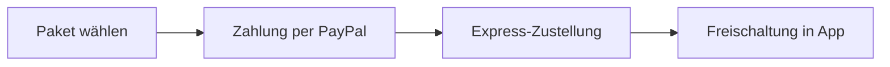

## Einleitung: Das Vertrauensproblem im Online-IPTV-Markt

Der Markt für Internet-Fernsehen wächst rasant. Wo hohe Nachfrage herrscht, tummeln sich im Internet jedoch leider auch fragwürdige Anbieter und unseriöse Reseller. Deutsche Verbraucher sind weltweit für ihr ausgeprägtes Sicherheitsbedürfnis bekannt: Niemand möchte sensible Kreditkartendaten auf unverschlüsselten Übersee-Websites eingeben oder sein Bankkonto für unüberschaubare Auslandsüberweisungen öffnen.

Besonders alarmierend: Viele dubiose Webseiten akzeptieren ausschließlich anonyme Kryptowährungen (wie Bitcoin oder USDT) oder Prepaid-Guthabenkarten (wie Paysafecard). Sobald das Geld dort überwiesen wurde, hat der Kunde bei Problemen oder Serverausfällen keinerlei rechtliche Handhabe oder Rückerstattungsmöglichkeit.

Die Lösung für maximale Transparenz und absolute Sicherheit lautet: **IPTV mit PayPal bezahlen**.

In diesem Ratgeber erfährst du, warum PayPal das sicherste Zahlungsmittel für Streaming-Abonnements in Deutschland darstellt, wie der integrierte **PayPal-Käuferschutz** funktioniert und wie du bei **German IPTV** in weniger als zwei Minuten deinen voll funktionsfähigen Premium-Zugang freischaltest.

---

## 1. Warum deutsche Kunden PayPal für IPTV bevorzugen

PayPal ist in Deutschland mit über 33 Millionen aktiven Konten der unangefochtene Marktführer unter den digitalen Bezahldiensten. Die Gründe für diese Dominanz spiegeln sich perfekt in den Anforderungen beim Online-Streaming-Kauf wider:

| Sicherheitsmerkmal | Zahlung mit PayPal | Kreditkarte auf dubiosen Seiten | Kryptowährungen (Bitcoin/USDT) |
| :--- | :--- | :--- | :--- |
| **Käuferschutz** | **Ja (Bis zu 180 Tage Schutz)** | Sehr schwer (Chargeback-Hürden) | **Keinerlei Schutz (Geld ist weg)** |
| **Datenschutz** | Händler sieht keine Bankdaten | Kreditkartennummer wird offengelegt | Wallet-Adresse öffentlich im Ledger |
| **Aktivierungsgeschwindigkeit** | **Sekundenschnell (Automatisiert)** | Oft manuelle Prüfung | Bestätigungszeiten der Blockchain |
| **Rückabwicklung bei Mängeln** | Unkompliziert mit 1 Klick | Bankformular & Sperrfristen | Technisch unmöglich |
| **Vertrauenswürdigkeit** | Weltweiter europäischer Standard | Hohes Risiko von Phishing | Häufig von Scammern genutzt |

---

## 2. Der PayPal-Käuferschutz: Dein digitaler Rettungsanker

Das stärkste Argument für den Kauf über PayPal ist der offizielle **PayPal-Käuferschutz**. 

Sollte ein Dienst wider Erwarten nicht der vereinbarten Leistungsbeschreibung entsprechen, der Zugang nicht rechtzeitig freigeschaltet werden oder ein technischer Totalausfall vorliegen, greift das Schutzprogramm von PayPal:

1. **Konfliktlösung im Kundenportal:** Du kannst innerhalb von 180 Tagen nach der Transaktion ein Problem direkt in deinem PayPal-Konto melden.
2. **Unabhängige Überprüfung:** PayPal fordert den Händler auf, den Nachweis über die ordnungsgemäße Bereitstellung der Dienstleistung zu erbringen.
3. **Geld-zurück-Erstattung:** Kann der Verkäufer die vereinbarte Leistung nicht lückenlos nachweisen, bucht PayPal den gezahlten Betrag vollumfänglich auf dein Bankkonto oder Guthaben zurück.

> **Wichtig für dich:** Seriöse Anbieter haben vor PayPal keine Angst. Da **German IPTV** eine garantierte Server-Verfügbarkeit von 99,9 % bietet und jeden Zugang innerhalb von 2 Minuten bereitstellt, bieten wir PayPal-Zahlungen aus tiefster Überzeugung an.

---

## 3. Die Warnsignale: Wann du einen Anbieter meiden solltest

Wenn du im Internet nach einem IPTV-Anbieter suchst, achte stets auf folgende rote Flaggen (*Red Flags*):

### 🚩 Rote Flagge 1: Ausschließlich Krypto- oder Gutscheinzahlung
Bietet eine Website ausschließlich Bitcoin, Ethereum oder Gutscheincodes (Amazon-Karten, Paysafecard) an und lehnt reguläre Bezahldienste wie PayPal oder Kreditkarte kategorisch ab? **Vorsicht!** Häufig handelt es sich um flüchtige Serverbetreiber, die nach einigen Monaten verschwinden und nicht mehr erreichbar sind.

### 🚩 Rote Flagge 2: Automatische Abo-Fallen und Daueraufträge
Vermeide Plattformen, die dir ein scheinbar günstiges Probe-Abo anbieten, dich jedoch im Kleingedruckten in einen 24-Monats-Vertrag mit automatischer monatlicher Lastschrift zwingen. Bei uns gibt es **keine Abofallen**: Jedes Paket (1, 3, 6 oder 12 Monate) läuft nach der bezahlten Periode automatisch aus, ohne Kündigungszwang.

### 🚩 Rote Flagge 3: Keine Kontaktmöglichkeit vor dem Kauf
Gibt es weder einen Live-Chat, noch eine WhatsApp-Support-Nummer oder eine offizielle E-Mail-Adresse? Ein seriöser Partner steht dir vor und nach dem Kauf für Fragen zur Verfügung.

---

## 4. Schritt-für-Schritt: So kaufst du IPTV mit PayPal bei German IPTV

Der Bestellprozess bei German IPTV ist auf maximale Einfachheit und Diskretion optimiert:

### Schritt 1: Tarif auswählen
Wähle auf unserer Preisseite das gewünschte Paket aus:
* **12 Monate (Testsieger - Bester Wert):** 55 € einmalig inkl. Premium Player (Rechnerisch nur 4,58 € / Monat).
* **6 Monate:** 30 € einmalig inkl. Premium Player.
* **3 Monate:** 20 € einmalig.
* **1 Monat:** 8 € flexibel ohne Bindung.

### Schritt 2: Sicher zur PayPal-Kasse
Klicke auf den Bestell-Button. Du wirst über eine gesicherte 256-Bit-SSL-Verschlüsselung direkt zur offiziellen PayPal-Zahlungsabwicklung weitergeleitet oder erhältst über unseren 24/7 WhatsApp-Kundendienst einen direkten PayPal-Zahlungslink.

### Schritt 3: Express-Lieferung in unter 2 Minuten
Unmittelbar nach Bestätigung der Transaktion generiert unser System deine persönlichen Xtream Codes Zugangsdaten und deine M3U-Playlist. Diese erhältst du sofort per E-Mail sowie auf Wunsch direkt per WhatsApp.

### Schritt 4: 24-Stunden-Zufriedenheitsgarantie
Du testest deinen neuen Zugang in aller Ruhe auf deinem Fire TV Stick, Smart TV oder Smartphone. Solltest du innerhalb der ersten 24 Stunden nicht zu 100 % begeistert sein, genügt eine kurze Nachricht an unseren Support und wir erstatten deine Zahlung anstandslos via PayPal zurück.

---

## 5. Häufig gestellte Fragen zu IPTV mit PayPal (FAQ)

### Kann ich bei PayPal auch per Lastschrift oder Kreditkarte ohne Guthaben zahlen?
Ja! Auch wenn du kein Guthaben auf deinem PayPal-Konto hast, bucht PayPal den Betrag bequem über dein verknüpftes deutsches Bankkonto (SEPA-Lastschrift) oder deine hinterlegte Visa/Mastercard ab.

### Erscheint das Wort „IPTV“ auf meinem Bankkontoauszug?
Nein. Bei der Abrechnung über PayPal erscheint auf deinem regulären Bankkontoauszug lediglich eine neutrale Abbuchung von PayPal, was deine Privatsphäre optimal schützt.

---

## 6. Fazit: Keine Kompromisse bei deiner Sicherheit

Gehe beim Kauf deines Streaming-Zugangs kein Risiko ein. Mit PayPal genießt du die volle Absicherung durch den offiziellen Käuferschutz, absolute Diskretion und eine bequeme Bezahlung ohne Weitergabe sensibler Bankdaten.

[Jetzt risikofrei mit PayPal bestellen — 12 Monate für nur 55 €](/iptv-kaufen/)
